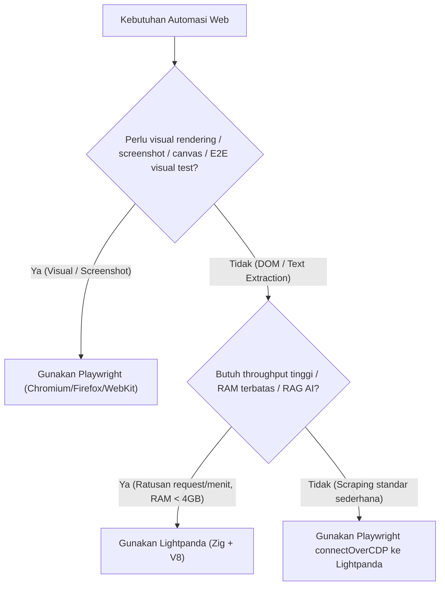

# Browser Automation Master (Playwright + Lightpanda) 🎀✨

Panduan master arsitektur, orkestrasi headless browser, dan automasi web untuk AI Agents. Menggabungkan ekosistem **Playwright** (full browser engine controller) dan **Lightpanda** (ultra-lightweight Zig/V8 headless browser runtime).

---

## 1. Konsep Dasar: Skill vs MCP (Apa Bedanya?)

| Komponen | Peran | Analogi | Wujud Fisik |
| :--- | :--- | :--- | :--- |
| **MCP (Model Context Protocol)** | **Tangan & Sensor (Hands & Eyes)**: Interface RPC yang memberi agent tool teknis untuk diklik, dinavigasi, dan dieksekusi secara runtime. | Remote Control / Obeng | Daemon/Server JSON-RPC stdio (`mcp_config.json`) |
| **Skill (SkillHub / SKILL.md)** | **Otak & Playbook (Brain & SOP)**: Panduan instruksi, strategi memilih tool, snippet kode, dan batas toleransi kegagalan. | Manual Operasional Pesawat | Dokumen Markdown (`D:\SkillHub\skills\<name>\SKILL.md`) |

> **Prinsip**: MCP memberi agent **kemampuan untuk membuka browser**, sedangkan Skill memberi agent **kebijaksanaan kapan harus pakai Playwright vs Lightpanda**.

---

## 2. Matrix Keputusan: Playwright vs Lightpanda



### Kapan Pakai Playwright?
- Membutuhkan **visual testing / screenshot** pixel-perfect.
- Halaman web bergantung pada **WebGL, Canvas 2D image data**, atau audio/video playback.
- Verifikasi E2E UI workflow yang menuntut layout engine akurat (`getBoundingClientRect()` nyata).
- Cross-browser testing (Chromium, Firefox, WebKit).

### Kapan Pakai Lightpanda?
- **AI Agent RAG / Web Scraping masif**: Ekstraksi artikel, markdown DOM, dan JSON data dari web SPA (React, Vue, Next.js).
- **RAM Sangat Hemat**: Mengonsumsi ~5–15 MB RAM per session (dibandingkan Chromium yang ~80–250 MB per tab).
- **Startup Sub-10ms**: Zero-delay browser context spawn menggunakan Zig memory arenas.

---

## 3. Instalasi & Setup di Windows

### A. Playwright (Windows Host)
Playwright berjalan secara native di Node.js host Windows:
```powershell
# Install Playwright test & browsers
npm install -g playwright
npx playwright install chromium
```

### B. Lightpanda (via WSL2 Ubuntu)
Karena Lightpanda merupakan binary native Linux/macOS (Zig), di Windows dijalankan via **WSL2**:
```bash
# Di dalam WSL Ubuntu:
curl -fSL https://github.com/lightpanda-io/browser/releases/download/nightly/lightpanda-x86_64-linux -o ~/.local/bin/lightpanda
chmod +x ~/.local/bin/lightpanda

# Verifikasi:
lightpanda --version
```

Menjalankan Lightpanda server sebagai daemon CDP di WSL:
```bash
lightpanda serve --host 0.0.0.0 --port 9222
```

---

## 4. Konfigurasi MCP (Model Context Protocol)

Tambahkan ke `~/.gemini/config/mcp_config.json`:

```json
{
  "mcpServers": {
    "playwright": {
      "command": "cmd.exe",
      "args": ["/c", "npx", "-y", "@playwright/mcp@latest"],
      "disabled": false
    },
    "lightpanda": {
      "command": "wsl.exe",
      "args": ["-d", "Ubuntu", "--", "bash", "-lic", "lightpanda mcp --obey-robots"],
      "disabled": false
    }
  }
}
```

---

## 5. Pola Integrasi: Hybrid Playwright + Lightpanda (CDP)

Agent dapat menulis script Node.js / TypeScript yang memanfaatkan API kaya milik Playwright, tetapi di-execute di atas engine ringan Lightpanda:

```javascript
import { chromium } from 'playwright';

async function fastScrape(url) {
  // Hubungkan Playwright ke daemon Lightpanda yang berjalan di localhost:9222
  const browser = await chromium.connectOverCDP('http://localhost:9222');
  const context = await browser.newContext();
  const page = await context.newPage();

  await page.goto(url, { waitUntil: 'domcontentloaded' });

  // Ekstraksi teks super cepat tanpa beban GPU & raster rendering
  const title = await page.title();
  const textContent = await page.evaluate(() => document.body.innerText);

  console.log(`[Success] Scraped: ${title}`);
  await browser.close();
  return { title, textContent };
}
```

---

## 6. CLI Quick Tools untuk Agent

1. **Lightpanda Dump URL ke Teks/DOM instan**:
   ```bash
   wsl -d Ubuntu -- bash -lic "lightpanda dump https://news.ycombinator.com"
   ```
2. **Playwright Codegen (Record & Generator Script)**:
   ```powershell
   npx playwright codegen https://example.com
   ```
