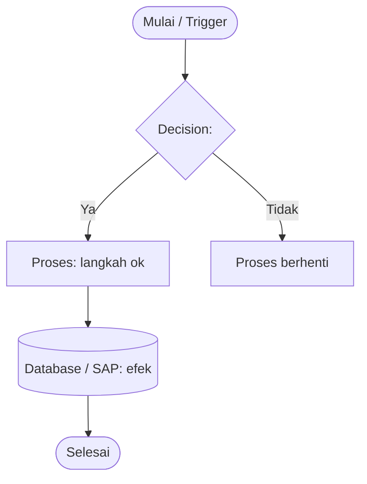

# SAP B1 Visual Logic Mapping (Mermaid Diagram Generation)

## Overview

**Core principle:** Transform a code path into a Mermaid flowchart whose nodes are business actions, whose branches are real decision nodes lifted from the code, and whose arrows carry the data that moves (Input → Process → Output/Database). Keep the diagram conceptual — no operators, no `return`, no SQL column dumps in nodes.

> **Catatan Deliverable FDD Korporat**: Untuk dokumen FDD resmi klien, standar baku PT Soltius Indonesia wajib menggunakan format native Draw.io XML (`.drawio`) dan PNG via [`corporate-flowchart-architect`](../corporate-flowchart-architect/SKILL.md) (palet `#4F88BB`, penomoran integer 1..N murni, tanpa fitur fiktif). Diagram Mermaid pada skill ini diperuntukkan bagi dokumentasi internal developer dan *quick preview* markdown.

## Decision-Node Detection

Find decision points automatically and render each as a Mermaid **diamond**:

| Code signal | Diagram meaning |
|---|---|
| `if` / `else if` / `switch` on a field or status | Decision diamond |
| `ItemEvent` `EventType` filter (`et_FORM_LOAD`, `et_ADD`, `et_UPDATE`, `et_BEFORE_ACTION`, `et_AFTER_ACTION`) | Entry gate diamond |
| status guard before post (must be `APPROVED`, `OPEN`) | Post gate diamond |
| toggle check (`SAP_ENABLE_CUSTOM_UDF`, `SAP_B1_AUTO_POST`) | Split into two diagram variants |
| `try/catch` | Error branch out of the try node |
| early `return` / cancel | "Proses berhenti" terminal |

Nested branches → subgraph. Sequential actions → arrow chain.

## Mermaid Flowchart Recipe



- Node shapes: `([ ])` start/end (stadium), `[ ]` process (rectangle), `{ }` decision (diamond), `[( )]` database/store, `[/ /]` input/output⇄.
- Keep node labels business language; put code anchors in a `%%` comment or a caption below the diagram.
- Use `subgraph` for: "VALIDASI", "POST KE SAP", "SINKRON KE SERVICE LAYER".
- Use `-.->` for async/side-effect (auto-post, email, background retry).
- Provide a **legend** line listing: diamond = keputusan, `(())=` DB/storage, dash = auto/async.

## Transformation Workflow

1. **Pick the source path**: Laravel route (`routes/web.php` + controller method) **or** C# handler (`Item_Event` + `FormDataEvent`) **or** Service Layer transaction.
2. **Sequentialize**: list actions in execution order.
3. **Mark decisions** with the condition that branches them.
4. **Attach data flow**: label arrows with what moves (e.g. `payload`, `DocEntry`, `status=APPROVED`).
5. **Emit Mermaid**; annotate the trigger and the primary output/database effect.
6. Optionally render a validation-only sub-diagram for the "Validasi Dokumen" set.

## Example (post path with gate)

```mermaid
flowchart TD
    A([Approve final klik]) --> B{Status dokumen = APPROVED?}
    B -- Tidak --> C[Blok: tampilkan pesan "belum disetujui"]
    B -- Ya --> D{Vendor terisi (CardCode)?}
    D -- Tidak --> E[Blok: "Vendor wajib dipilih"]
    D -- Ya --> F[Susun payload buildDocumentPayload]
    F --> G{Mode UDF aktif?}
    G -- Ya --> H[Payload + U_SOL_* fields]
    G -- Tidak --> I[Payload standard SAP]
    H --> J[POST /b1s/v2/PurchaseOrders]
    I --> J
    J --> K{(HTTP 401?)}
    K -- Ya --> L["Re-login + backoff"] --> J
    K -- Tidak --> M["201: simpan DocEntry (SYNCED)"]
    M --> N([Selesai])
```

## Checks Before Delivery

- Every diamond has `Ya`/`Tidak` (or equiv) labels on both outgoing edges.
- One path per branch leads to a terminal or a DB/storage node — no dangling arrows.
- Start node says the trigger; end node names the outcome/state.
- No C# conditionals or SQL column names inside node labels.
- Caption under diagram: source file + functions (`SapB1Service::createDocument`).

## Common mistakes

- Drawing code structures (loops, operators) instead of business actions.
- Diamond with only one labeled edge (unlabeled "else").
- Ambiguous labels — "Proses" is a default, not a description.
- Mixing too many system boundaries into one graph (use subgraphs per boundary).
- Forgetting the legend and the source anchor.

## Quick reference

| Source signal | Mermaid shape |
|---|---|
| route / controller entry | stadium `([Trigger])` |
| sequential action | rectangle `[Action]` |
| condition / guard | diamond `{Kondisi}` |
| DB write / SAP post | cylinder `[(Database/SAP)]` |
| async / side-effect / auto | dashed `-.->` |
| error / cancel path | diamond + terminal "Berhenti" |

## Draw.io Alternative (via `drawio-skill`)

Selain Mermaid, logika bisnis dapat diekspor langsung ke format diagram editable `.drawio` menggunakan skill **[`drawio-skill`](../drawio-skill/SKILL.md)**:
- Spesifikasi resmi: [draw.io AI Diagram Generation](https://www.drawio.com/docs/reference/diagram-generation/) & [Style Reference](https://www.drawio.com/docs/reference/diagram-generation/style-reference/).
- Konversi Mermaid ke Draw.io native atau buat langsung model XML `<mxGraphModel>` dengan layout orthogonal otomatis untuk disematkan dalam FDD.
